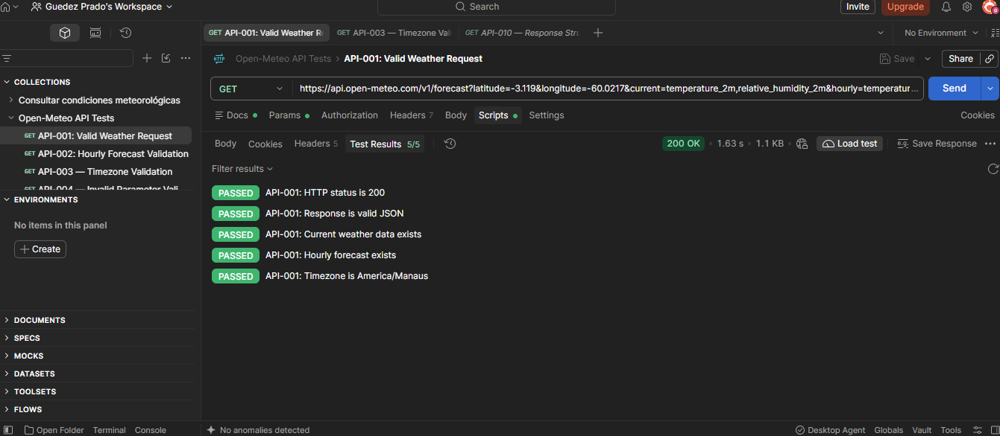
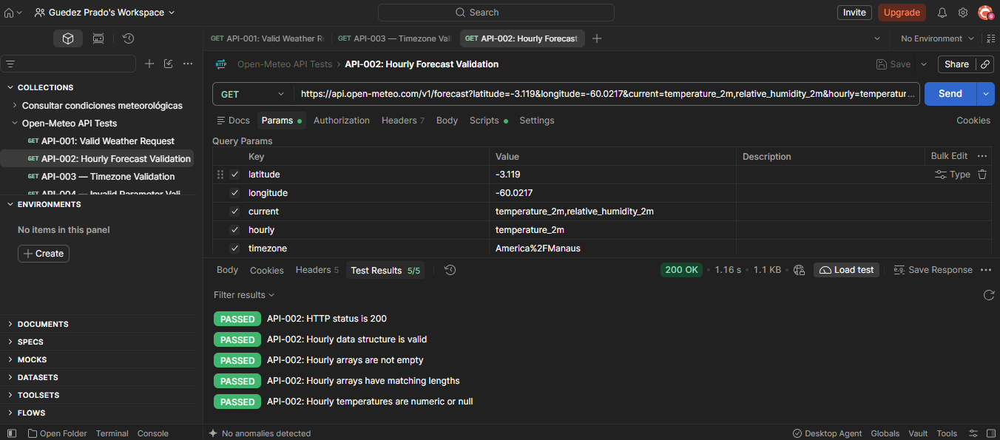
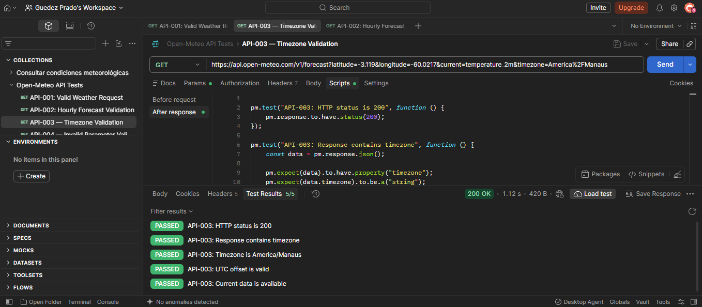
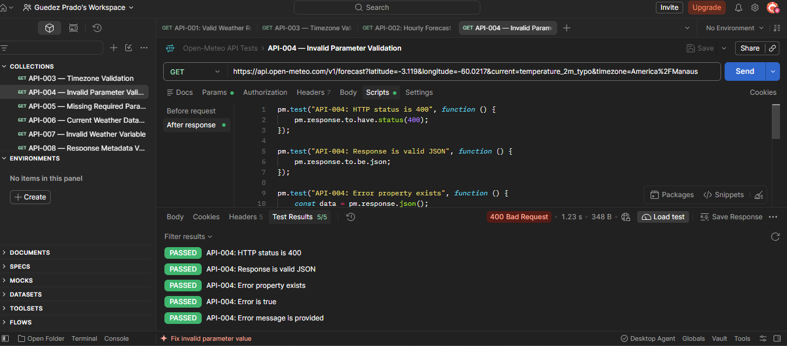
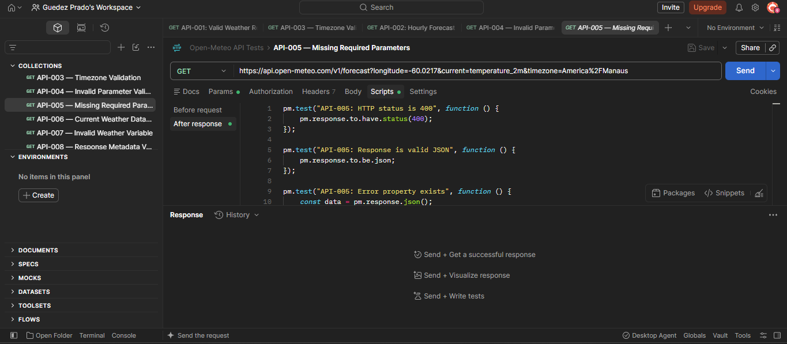
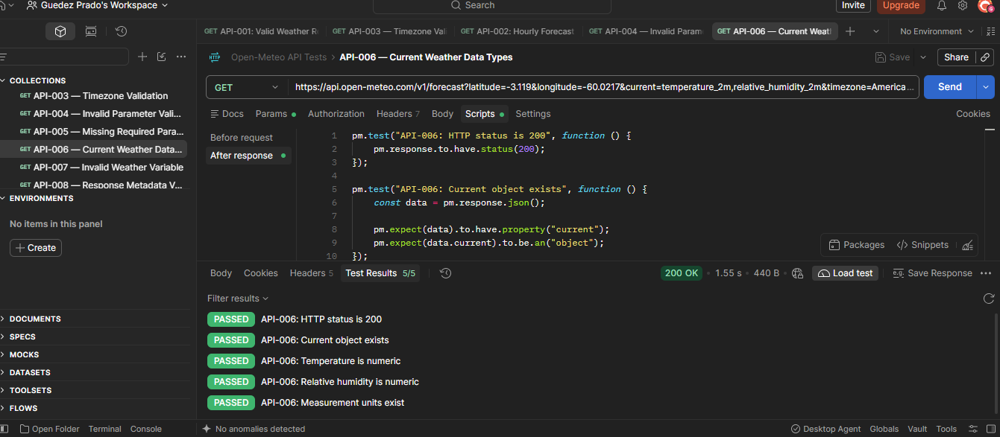
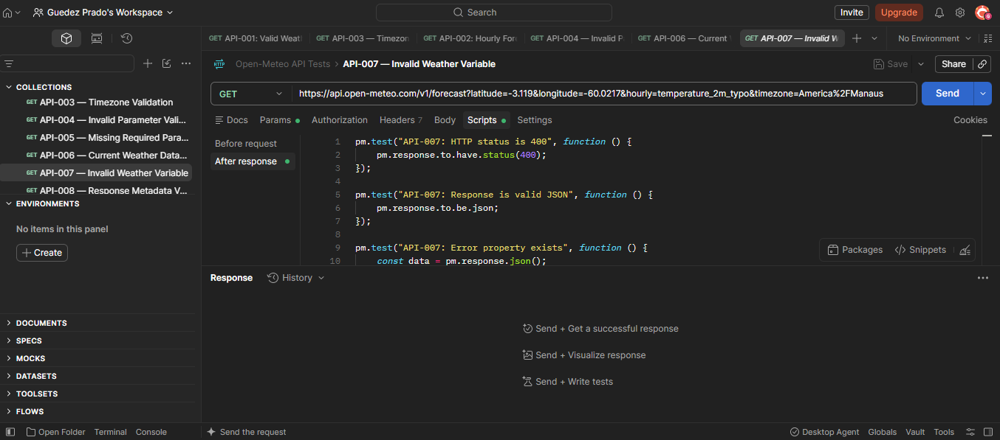
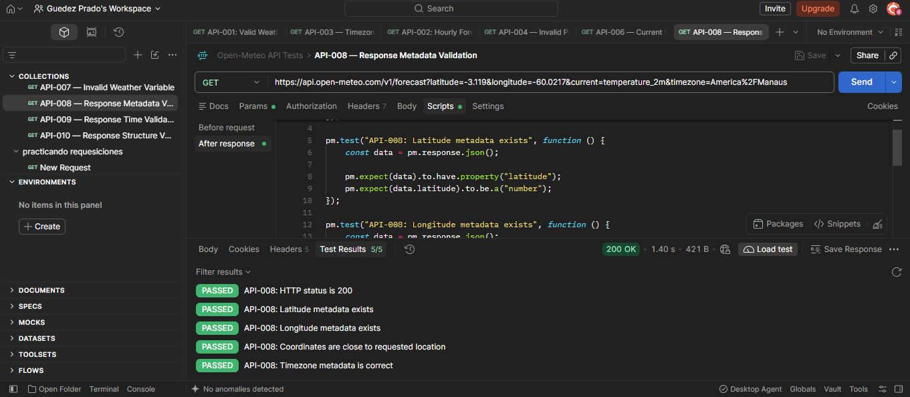
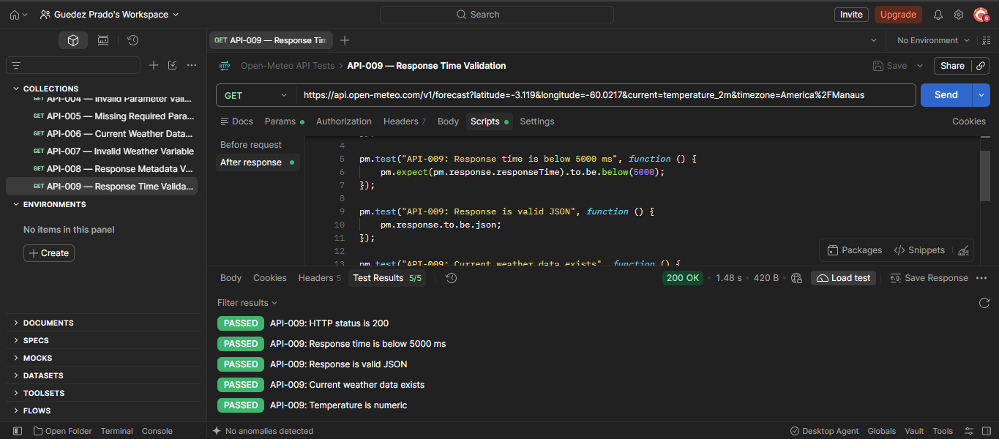
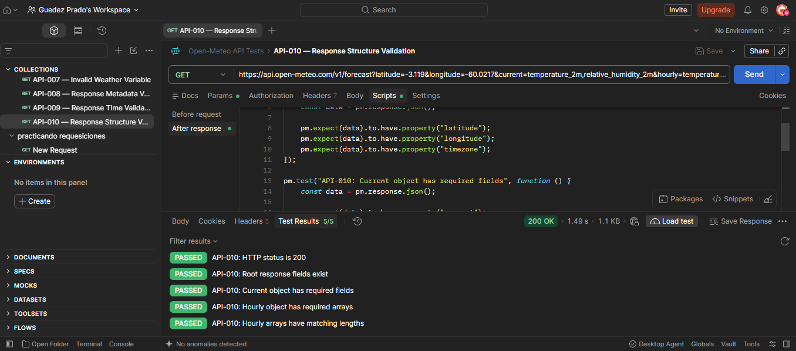

# Test Evidence — Open-Meteo API Testing

## 1. Objetivo

Este documento organiza as evidências das execuções dos casos de teste realizados com Postman e os registros de acompanhamento no Jira.

## 2. Evidências do Postman

As capturas de tela devem mostrar, sempre que possível, o nome do caso de teste, a requisição executada, o código HTTP e o painel **Test Results**.

| ID | Evidência recomendada | O que comprova |
|---|---|---|
| API-001 | Requisição válida e painel Test Results | Resposta HTTP 200 e validações da resposta meteorológica |
| API-002 | Resultado das validações horárias | Estrutura e consistência dos arrays de previsão |
| API-003 | Resultado da validação de fuso horário | Fuso horário e metadados relacionados |
| API-004 | Resposta 400 e Test Results | Tratamento de parâmetro inválido |
| API-005 | Resposta 400 e Test Results | Tratamento da ausência de latitude |
| API-006 | Resposta e validações de tipos de dados | Temperatura, umidade e unidades de medida |
| API-007 | Resposta 400 e Test Results | Tratamento de variável meteorológica inválida |
| API-008 | Metadados da resposta e Test Results | Coordenadas e fuso horário |
| API-009 | Tempo de resposta e Test Results | Tempo observado de 1.600 ms, abaixo do limite definido de 5.000 ms |
| API-010 | Estrutura JSON e Test Results | Presença dos campos e consistência dos arrays |

## 3. Evidências do Jira

O Jira é utilizado para registrar os resultados dos cenários, acompanhar as atividades de QA e manter o histórico de execução.

Os comentários de cada caso devem documentar:

- Identificação do caso de teste.
- Data de execução.
- Endpoint e cenário.
- Resultado HTTP observado.
- Validações realizadas.
- Resultado das asserções.
- Conclusão e referência à evidência do Postman.

## 4. Organização dos arquivos

## Evidence Screenshots

## Evidence Screenshots

The following screenshots document the execution of the API test cases in Postman.

### API-001 — Valid Weather Request

### API-002 — Hourly Forecast Validation

### API-003 — Timezone Validation

### API-004 — Invalid Parameter Validation

### API-005 — Missing Required Parameters

### API-006 — Response Structure Integrity

### API-007 — Invalid Endpoint Check

### API-008 — Temperature Unit Parameter

### API-009 — Maximum Past Days Parameter

### API-010 — Response Time Performance

## 5. Critérios de qualidade das evidências

- A captura deve permitir identificar o caso de teste.
- O código HTTP e o resultado das asserções devem estar legíveis.
- Tokens, credenciais e dados privados não devem aparecer nas imagens.
- Resultados e conclusões devem corresponder à execução real.
- Os tempos de resposta devem ser descritos como observações daquela execução, não como garantia de desempenho permanente.

## 6. Status

Este documento define a estrutura de organização das evidências. As capturas serão adicionadas após serem selecionadas e verificadas.
